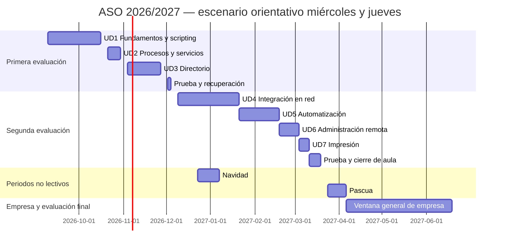

# Calendario y organización de ASO 2026/2027 — Elche

**Cuatro horas semanales. Dos evaluaciones en el centro y formación en empresa durante los últimos meses.** Actualizado: 16 de septiembre de 2026.

Aquí puedes consultar el orden de las unidades, las horas previstas de clase y los periodos de evaluación y formación en empresa.

!!! warning "Fechas de unidades y plan de empresa por concretar"
    El horario confirmado es de miércoles y jueves, dos horas cada día. Las fechas de las unidades y las pruebas son orientativas; consúltalas con el profesorado antes de organizarte. La ventana general de formación en empresa va del 6 de abril al 18 de junio de 2027. Cada estudiante tendrá fechas y jornada concretas según su empresa y su plan formativo.

## Calendario escolar de Elche

| Concepto | Fecha o periodo |
|---|---|
| Inicio de FP | 9 de septiembre de 2026 |
| Navidad | 23 de diciembre de 2026 – 6 de enero de 2027, incluidos |
| Pascua | 24 de marzo – 5 de abril de 2027, incluidos |
| No lectivos locales de Elche | 7 de diciembre, 12 de febrero y 3 de mayo |
| Otros festivos dentro del calendario | 9 y 12 de octubre, 8 de diciembre y 19 de marzo |
| Fin del curso escolar de FP | 18 de junio de 2027 |

Se utiliza el calendario definitivo autorizado para Elche, que modifica el general autonómico. En El Altet, el 12 de febrero se sustituye por el 2 de octubre. Fuente: [Ayuntamiento de Elche, calendario definitivo publicado en agosto de 2026](https://www.elche.es/2026/08/elche-aprueba-el-calendario-escolar-definitivo-para-el-curso-2026-2027-con-un-no-lectivo-mas-en-semana-santa/).

## Horas del módulo

ASO tiene **133 horas curriculares y 4 horas semanales**, según el [Decreto 114/2025, tabla de ASIR, página 72](https://dogv.gva.es/datos/2025/08/04/pdf/2025_29742_es.pdf).

| Organización prevista | Horas |
|---|---:|
| Trabajo de las unidades UD1–UD7 en el centro | 92 |
| Pruebas, recuperación y cierre en el centro | 10 |
| **Total previsto en el centro** | **102** |
| **Duración curricular oficial del módulo** | **133** |

**El decreto fija 133 horas y 4 horas semanales. No establece el reparto 102 horas en el centro y 31 en empresa.** Las 102 horas proceden exclusivamente del ejemplo de calendario desarrollado a continuación, con clases los miércoles y jueves y una última sesión calculada el 18 de marzo. La diferencia aritmética de 31 horas muestra que ese ejemplo no constituye la temporalización completa del módulo; no es una bolsa de horas establecida por la norma ni una asignación a empresa. El reparto definitivo debe concretarse con las fechas de evaluación y el plan formativo del grupo. Los porcentajes de los resultados de aprendizaje indican su peso en la evaluación, no su duración.

## Unidades y evaluaciones en el centro

Con el horario confirmado de miércoles y jueves y el periodo de aula propuesto hasta el 23 de marzo, se prevén **51 sesiones, 102 horas**, distribuidas en 92 horas para unidades y 10 para pruebas, recuperación y cierre. Las fechas de cada fila corresponden a su primera y última sesión; no implican clase todos los días del intervalo.

### Primera evaluación: septiembre – 3 de diciembre

| Bloque | Primera sesión | Última sesión | Horas de aula |
|---|---|---|---:|
| UD1. Fundamentos y scripting | 09/09/2026 | 15/10/2026 | 24 |
| UD2. Procesos y servicios | 21/10/2026 | 29/10/2026 | 8 |
| UD3. Servicios de directorio | 04/11/2026 | 26/11/2026 | 16 |
| Prueba y recuperación | 02/12/2026 | 03/12/2026 | 4 |
| **Total** | | | **52** |

UD1 incluye unas cinco horas de fundamentos dentro de sus 24 horas. Se prioriza Linux y se mantiene el trabajo necesario con sistemas propietarios para las evidencias que lo requieran; no se suma el repaso al presupuesto de horas.

### Segunda evaluación: 9 de diciembre – 18 de marzo

| Bloque | Primera sesión | Última sesión | Horas de aula |
|---|---|---|---:|
| UD4. Integración de sistemas en red | 09/12/2026 | 20/01/2027 | 16 |
| UD5. Automatización de tareas y monitorización del sistema | 21/01/2027 | 17/02/2027 | 16 |
| UD6. Administración remota | 18/02/2027 | 03/03/2027 | 8 |
| UD7. Impresión | 04/03/2027 | 10/03/2027 | 4 |
| Prueba, recuperación y preparación de empresa | 11/03/2027 | 18/03/2027 | 6 |
| **Total** | | | **50** |

Las sesiones de evaluación del equipo docente deben fijarlas el centro. Aquí las filas de prueba y recuperación reservan horas de clase; no se presentan como convocatorias oficiales ni como evaluación final del módulo.

### Cómo trabajarás las unidades

- En UD1 repasarás fundamentos de Linux y trabajarás scripting en Linux y PowerShell.
- En UD3 y UD4 reutilizarás el entorno LDAP y los usuarios en las prácticas de integración.
- En UD5 realizarás una selección de actividades de automatización y monitorización. El material completo incluye ampliaciones; el profesorado indicará las actividades obligatorias y las entregas.
- En UD6 y UD7 trabajarás la administración remota y los servicios de impresión.

Las [actividades de fundamentos de Linux](UD1/linux/fundamentos/Actividades.md) son obligatorias, incluida la explicación individual de cada comando propuesto. Para los materiales identificados expresamente como refuerzo o ampliación en otras unidades, el profesorado indicará las entregas.

## Formación en empresa y evaluación final

El centro ha confirmado como **ventana general de formación en empresa el periodo del 6 de abril al 18 de junio de 2027**. No todo el alumnado empezará o terminará el mismo día. La jornada, los festivos, las actividades y el seguimiento de cada estudiante se concretarán con su empresa en el plan formativo.

El centro ha confirmado **400 horas de empresa en segundo curso** para el conjunto del ciclo. No son 400 horas de ASO: los RA, las actividades y las horas que correspondan al módulo se concretarán en el plan formativo. Como referencia, **400 horas equivalen a 50 jornadas de ocho horas**. El número de días y las fechas reales dependen de la jornada y del calendario de cada empresa.

La evaluación final tendrá en cuenta la formación realizada en empresa. Terminar las clases de la segunda evaluación no supone haber cerrado el módulo. Consulta los [resultados de aprendizaje y la evaluación](index.md#evaluacion).

## Diagrama de la propuesta

Las barras señalan intervalos, no horas de clase continuas. Las fechas de fin del diagrama son exclusivas para abarcar la última sesión indicada en las tablas.

## Información pendiente de confirmar

El profesorado y el centro deben concretar las fechas de pruebas y recuperación, la temporalización completa de las 133 horas y el plan de formación en empresa. Las fechas de las unidades y pruebas son orientativas. La ventana general de empresa es del 6 de abril al 18 de junio de 2027; las fechas individuales, la jornada, los festivos y las actividades quedan pendientes de cada plan formativo.
