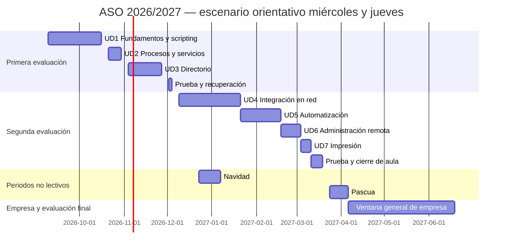

# Temporalización ASO 2026/2027 — Elche

**Cuatro horas semanales. Dos evaluaciones en el centro y formación en empresa durante los últimos meses.** Revisión horaria: 16 de septiembre de 2026.

El calendario municipal está contrastado. Las fechas de las unidades siguen siendo una **propuesta de organización**. La ventana general de formación en empresa, del 6 de abril al 18 de junio de 2027, está confirmada por el centro; las fechas individuales se concretarán con cada empresa. Para calcular las sesiones se ha usado el horario confirmado de miércoles y jueves, dos horas cada día.

## Calendario escolar de Elche

| Concepto | Fecha o periodo |
|---|---|
| Inicio de FP | 9 de septiembre de 2026 |
| Navidad | 23 de diciembre de 2026 – 6 de enero de 2027, incluidos |
| Pascua | 24 de marzo – 5 de abril de 2027, incluidos |
| No lectivos locales de Elche | 7 de diciembre, 12 de febrero y 3 de mayo |
| Otros festivos dentro del calendario | 9 y 12 de octubre, 8 de diciembre y 19 de marzo |
| Fin del curso escolar de FP | 18 de junio de 2027 |

Se utiliza el calendario definitivo autorizado para Elche, que modifica el general autonómico. En El Altet, el 12 de febrero se sustituye por el 2 de octubre. Fuente: [Ayuntamiento de Elche, calendario definitivo publicado en agosto de 2026](https://www.elche.es/2026/08/elche-aprueba-el-calendario-escolar-definitivo-para-el-curso-2026-2027-con-un-no-lectivo-mas-en-semana-santa/).

## Qué significan las 400 horas de empresa

Las instrucciones de FP de 2026/2027 establecen, para régimen general de grado medio/superior, entre el 25 % y el 35 % de la duración del ciclo en empresa, repartida entre cursos, y un mínimo de 100 horas en primero. En un ciclo de 2.000 horas, el intervalo es **500–700 horas**. El centro ha confirmado **400 horas de empresa en segundo curso**. Si en primero se realizaron 100 horas, la suma sería de 500 horas y cumpliría el mínimo indicado; las horas efectivas de primero deben comprobarse en el plan formativo del grupo. [Resolución de 16 de julio de 2026, apartado 15.1.1, páginas 21–22](https://www.mclibre.org/consultar/legislacion/files/dogv/DOGV-2026-07-16-R-inicio-curso-fp-2627-es.pdf).

Las 400 horas de segundo corresponden al conjunto del ciclo; no son 400 horas del módulo ASO. El currículo asigna a ASO **133 horas y 4 horas semanales**. [Decreto 114/2025, tabla de ASIR, página 72](https://dogv.gva.es/datos/2025/08/04/pdf/2025_29742_es.pdf).

## Balance de horas del módulo

La programación DOCX y esta web utilizan la misma referencia: **133 horas curriculares y 4 horas semanales**. Las antiguas cifras de 120 horas y 6 semanales se han retirado de las tablas del DOCX.

| Concepto | Horas | Estado |
|---|---:|---|
| Total curricular de ASO | **133** | Referencia del Decreto 114/2025 |
| Unidades UD1–UD7 en el centro | 92 | Horario miércoles/jueves confirmado; fechas propuestas |
| Pruebas, recuperación y cierre en el centro | 10 | Incluidas en el escenario de aula |
| **Subtotal de aula** | **102** | 92 + 10; fechas de evaluación pendientes |

El decreto establece 133 horas y 4 horas semanales; no establece un reparto de 102 horas en el centro y 31 en empresa. Las 102 horas son el resultado del periodo de aula propuesto con el horario confirmado. La diferencia aritmética de 31 horas indica que ese escenario no cubre la temporalización completa del módulo, no una bolsa de horas impuesta por la norma. La distribución definitiva requiere las fechas de evaluación y el plan formativo del grupo. Los pesos de evaluación de los RA no son porcentajes de horas.

## Escenario calculado de clases en el centro

Calendario de cálculo: clases los miércoles y jueves, dos horas por sesión, en el periodo comprendido hasta el 23 de marzo; la última sesión lectiva calculada es el 18 de marzo. Se descuentan los no lectivos anteriores. Resultan **51 sesiones, 102 horas**, distribuidas en 92 horas para unidades y 10 para pruebas, recuperación y cierre. Las fechas de cada fila corresponden a su primera y última sesión; no implican clase todos los días del intervalo.

### Primera evaluación: septiembre – 3 de diciembre

| Bloque | Primera sesión | Última sesión | Horas de aula |
|---|---|---|---:|
| UD1. Fundamentos y scripting | 09/09/2026 | 15/10/2026 | 24 |
| UD2. Procesos y servicios | 21/10/2026 | 29/10/2026 | 8 |
| UD3. Servicios de directorio | 04/11/2026 | 26/11/2026 | 16 |
| Prueba y recuperación | 02/12/2026 | 03/12/2026 | 4 |
| **Total** | | | **52** |

UD1 incluye unas cinco horas de fundamentos dentro de sus 24 horas. Se prioriza Linux y se mantiene el trabajo necesario con sistemas propietarios para las evidencias que lo requieran; no se suma el repaso al presupuesto de horas.

### Segunda evaluación: 9 de diciembre – 18 de marzo

| Bloque | Primera sesión | Última sesión | Horas de aula |
|---|---|---|---:|
| UD4. Integración de sistemas en red | 09/12/2026 | 20/01/2027 | 16 |
| UD5. Automatización de tareas y monitorización del sistema | 21/01/2027 | 17/02/2027 | 16 |
| UD6. Administración remota | 18/02/2027 | 03/03/2027 | 8 |
| UD7. Impresión | 04/03/2027 | 10/03/2027 | 4 |
| Prueba, recuperación y preparación de empresa | 11/03/2027 | 18/03/2027 | 6 |
| **Total** | | | **50** |

Las sesiones de evaluación del equipo docente deben fijarlas el centro. Aquí las filas de prueba y recuperación reservan horas de clase; no se presentan como convocatorias oficiales ni como evaluación final del módulo.

### Ajustes respecto al material completo

Este escenario no pretende desarrollar todos los ejercicios existentes en las horas reducidas. Se seleccionan prácticas integradas para reutilizar servidores y evidencias:

- UD3 y UD4 comparten el entorno LDAP y los usuarios; no se reinstala el laboratorio desde cero en cada unidad.
- UD5 conserva un itinerario completo de 24 horas como material de referencia y propone una selección de 16 horas: preparación de scripts (2), cron/at/KCron (4), timers (4), fiabilidad y cuentas (3), caso integrado y evidencias (3). Se parte de los scripts entregados y se reutilizan resultados, sin eliminar las evidencias de los criterios gráficos y de cuentas.
- UD6 reutiliza los servidores anteriores; UD7 se centra en una cola y pruebas desde cliente.
- Las actividades adicionales quedan como ampliación o refuerzo, sin computarlas ficticiamente como horas de clase.

**Este escenario de aula no es la temporalización completa del módulo.** La diferencia 133 − 102 = 31 procede de las hipótesis de calendario utilizadas, no de un reparto normativo entre centro y empresa. El equipo docente debe cerrar la planificación con las fechas de evaluación y las actividades y resultados de aprendizaje del plan formativo. Las ponderaciones de RA no cambian por reducir el tiempo de un bloque.

### Alcance del cálculo

Hasta el 23 de marzo hay 24 lunes, 25 martes, 25 miércoles, 26 jueves y 23 viernes lectivos en el calendario considerado. Los 25 miércoles y 26 jueves lectivos suman **51 sesiones y 102 horas** a razón de dos horas cada día. Las fechas de pruebas y empresa siguen pendientes de aprobación.

## Ventana general de formación en empresa

El centro ha confirmado una **ventana general del 6 de abril al 18 de junio de 2027** para la formación en empresa. Las fechas de incorporación y finalización, la jornada, los festivos y las actividades de cada estudiante se concretarán en su plan formativo.

Como referencia aritmética, **400 horas requieren 50 jornadas efectivas de ocho horas**. La ventana general contiene 54 días de lunes a viernes, pero cada estudiante puede incorporarse en una fecha distinta y tener un calendario laboral propio. Por ello, el día de finalización se calculará en cada plan formativo; las 50 jornadas no son un calendario común para todo el alumnado.

El calendario efectivo de empresa debe incorporar los festivos aplicables, la asistencia al centro y el seguimiento acordados. Los días no lectivos escolares no se convierten automáticamente en días sin actividad en empresa. La evaluación final tendrá en cuenta la formación realizada allí; no se considera cerrado ASO solo por terminar la segunda evaluación de aula. [Instrucciones 2026/2027, apartados 9.6 y 15](https://www.mclibre.org/consultar/legislacion/files/dogv/DOGV-2026-07-16-R-inicio-curso-fp-2627-es.pdf).

## Diagrama de la propuesta

Las barras señalan intervalos, no horas de clase continuas. Las fechas de fin del diagrama son exclusivas para abarcar la última sesión indicada en las tablas.

## Datos que debe cerrar el centro

Las fechas de evaluación de ASO, las horas de empresa realizadas en primero, los resultados de aprendizaje que se desarrollarán en empresa, las fechas individuales de empresa, las jornadas, los festivos aplicables y las fechas de evaluación. Estos datos concretan la propuesta; el calendario municipal y las cuatro horas semanales ya están incorporados.
